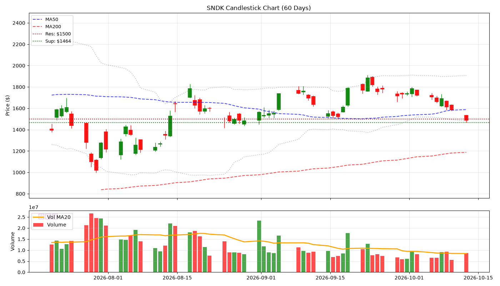
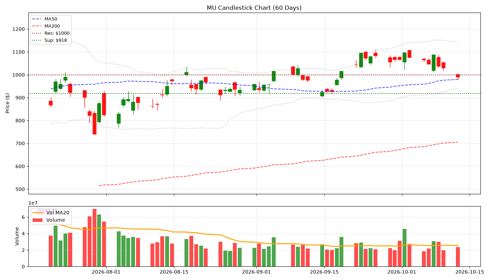
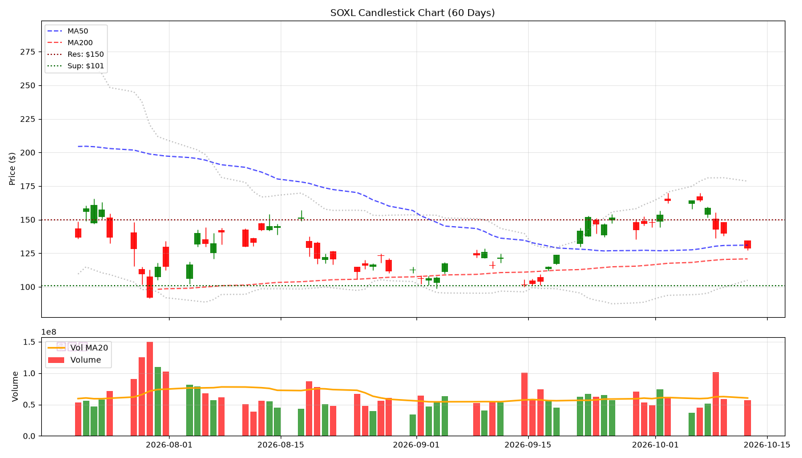
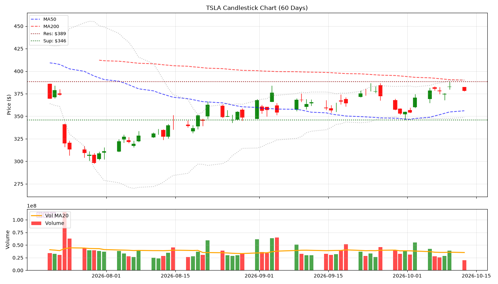
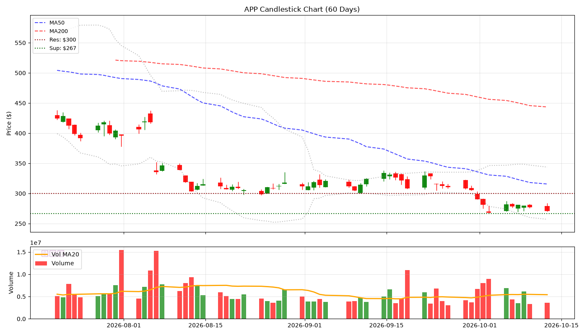
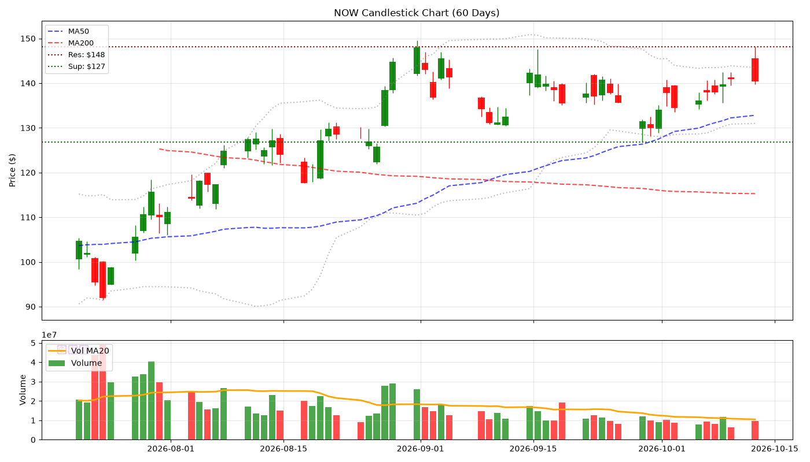
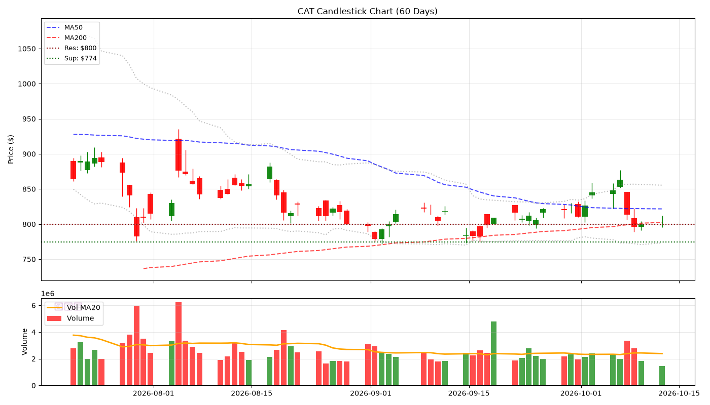
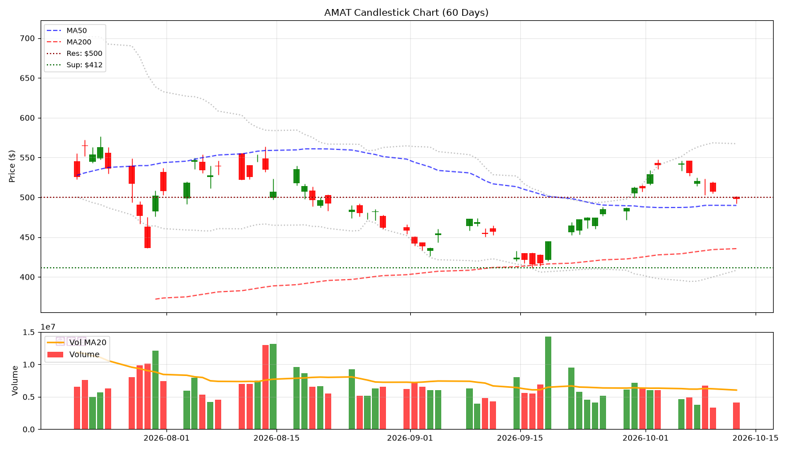
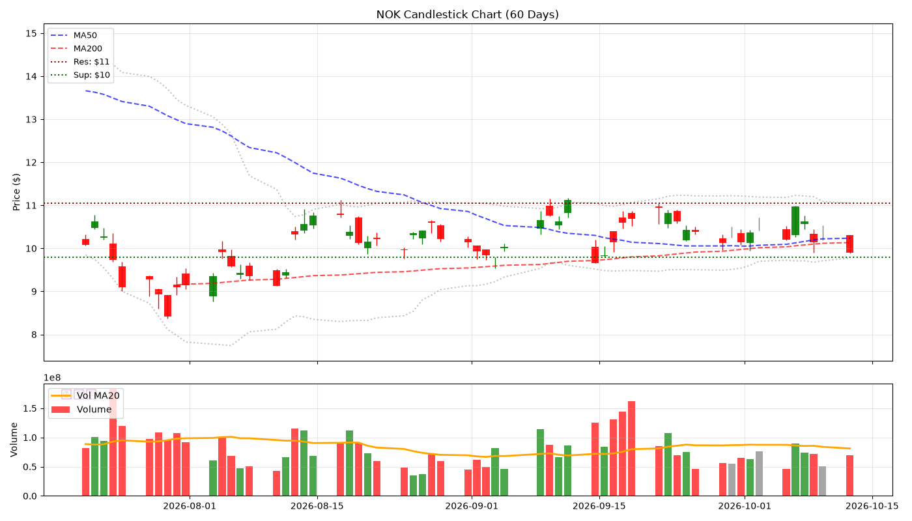
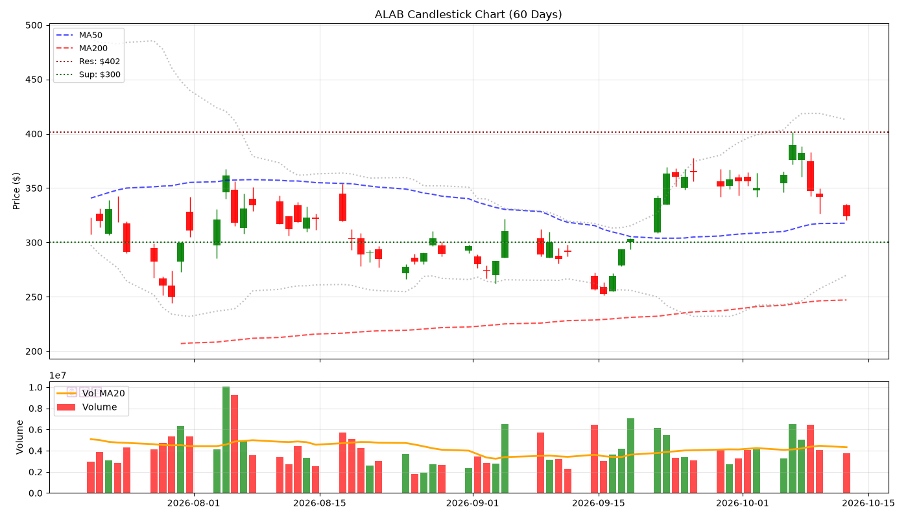

# 🕯️ Hermes V5 陰陽燭專業日報 - 2026-10-13
> **生成時間**: 2026-10-13 06:00:31 | **圖表**: 正宗陰陽燭 + Volume

---

## 📊 核心數據

| 股票 | 價格 | 漲跌% | RSI | 成交量 | 阻力 | 支撐 |
|------|------|-------|-----|--------|------|------|
| SNDK | $1487.33 | -5.97% | 19.8 | 💧 | $1500 | $1464 |
| MU | $989.04 | -3.88% | 32.1 | 💧 | $1000 | $918 |
| SOXL | $128.40 | -8.13% | 34.9 | 💧 | $150 | $101 |
| TSLA | $378.03 | -1.22% | 49.4 | 💧 | $389 | $346 |
| APP | $270.87 | -2.23% | 18.0 | 💧 | $300 | $267 |
| NOW | $140.32 | -0.38% | 55.0 | 💧 | $148 | $127 |
| CAT | $799.37 | -0.14% | 47.6 | 💧 | $800 | $774 |
| AMAT | $497.53 | -1.87% | 60.8 | 💧 | $500 | $412 |
| NOK | $9.90 | -4.44% | 39.3 | 💧 | $11 | $10 |
| ALAB | $324.11 | -5.29% | 36.0 | 💧 | $402 | $300 |

---

## 📈 個股陰陽燭分析

### SNDK ($1487.33, -5.97%)

- **RSI**: 19.8 | **Vol**: NORMAL
- **關鍵位**: 阻力 $1500.00 | 支撐 $1464.43

### MU ($989.04, -3.88%)

- **RSI**: 32.1 | **Vol**: NORMAL
- **關鍵位**: 阻力 $1000.00 | 支撐 $917.64

### SOXL ($128.40, -8.13%)

- **RSI**: 34.9 | **Vol**: NORMAL
- **關鍵位**: 阻力 $150.00 | 支撐 $100.96

### TSLA ($378.03, -1.22%)

- **RSI**: 49.4 | **Vol**: NORMAL
- **關鍵位**: 阻力 $388.56 | 支撐 $345.88

### APP ($270.87, -2.23%)

- **RSI**: 18.0 | **Vol**: NORMAL
- **關鍵位**: 阻力 $300.00 | 支撐 $266.84

### NOW ($140.32, -0.38%)

- **RSI**: 55.0 | **Vol**: NORMAL
- **關鍵位**: 阻力 $148.14 | 支撐 $126.75

### CAT ($799.37, -0.14%)

- **RSI**: 47.6 | **Vol**: NORMAL
- **關鍵位**: 阻力 $800.00 | 支撐 $774.48

### AMAT ($497.53, -1.87%)

- **RSI**: 60.8 | **Vol**: NORMAL
- **關鍵位**: 阻力 $500.00 | 支撐 $411.51

### NOK ($9.90, -4.44%)

- **RSI**: 39.3 | **Vol**: NORMAL
- **關鍵位**: 阻力 $11.05 | 支撐 $9.80

### ALAB ($324.11, -5.29%)

- **RSI**: 36.0 | **Vol**: NORMAL
- **關鍵位**: 阻力 $401.74 | 支撐 $300.00

*Generated by Hermes Agent V5 (Candlestick Pro)*